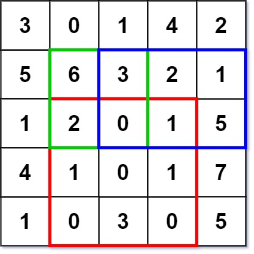
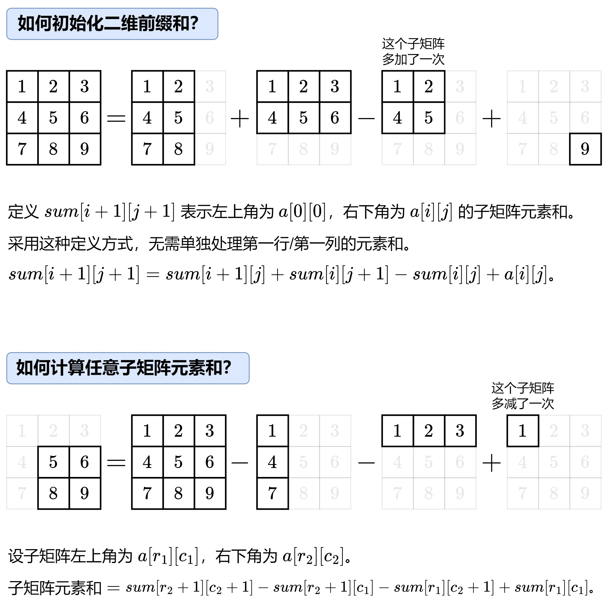

# 二维前缀和
[题目链接](https://leetcode.cn/problems/range-sum-query-2d-immutable/description/)

## 题目描述
计算其子矩形范围内元素的总和，该子矩阵的 左上角 为 (row1, col1) ，右下角 为 (row2, col2) 。

实现 NumMatrix 类：

NumMatrix(int[][] matrix) 给定整数矩阵 matrix 进行初始化

int sumRegion(int row1, int col1, int row2, int col2) 返回 左上角 (row1, col1) 、右下角 (row2, col2) 所描述的子矩阵的元素 总和 。



输入: 

["NumMatrix","sumRegion","sumRegion","sumRegion"]

[[[[3,0,1,4,2],[5,6,3,2,1],[1,2,0,1,5],[4,1,0,1,7],[1,0,3,0,5]]],[2,1,4,3],[1,1,2,2],[1,2,2,4]]

输出: 

[null, 8, 11, 12]

解释:
NumMatrix numMatrix = new NumMatrix([[3,0,1,4,2],[5,6,3,2,1],[1,2,0,1,5],[4,1,0,1,7],[1,0,3,0,5]]);

numMatrix.sumRegion(2, 1, 4, 3); // return 8 (红色矩形框的元素总和)

numMatrix.sumRegion(1, 1, 2, 2); // return 11 (绿色矩形框的元素总和)

numMatrix.sumRegion(1, 2, 2, 4); // return 12 (蓝色矩形框的元素总和)
 
## 解题思路
暴力解法并不难，但如果数据量一大，时间复杂度就会爆炸

如果想在`O(1)`的时间复杂度内返回答案，最好的办法就是对矩阵进行**预处理**



值得注意的是，可以使用`resize()`来重构已经声明的`vector`数组，这样就避免了提前声明却又不知道大小，知道大小再声明又无法作为全局变量访问的尴尬

## 代码

```c++
class NumMatrix {
    vector<vector<int>> sum;

public:
    NumMatrix(vector<vector<int>>& matrix) {
        int m = matrix.size(), n = matrix[0].size();
        sum.resize(m + 1, vector<int>(n + 1));
        for (int i = 0; i < m; i++) {
            for (int j = 0; j < n; j++) {
                sum[i + 1][j + 1] = sum[i + 1][j] + sum[i][j + 1] - sum[i][j] + matrix[i][j];
            }
        }
    }

    // 返回左上角在 (r1, c1) 右下角在 (r2, c2) 的子矩阵元素和
    int sumRegion(int r1, int c1, int r2, int c2) {
        return sum[r2 + 1][c2 + 1] - sum[r2 + 1][c1] - sum[r1][c2 + 1] + sum[r1][c1];
    }
};
```