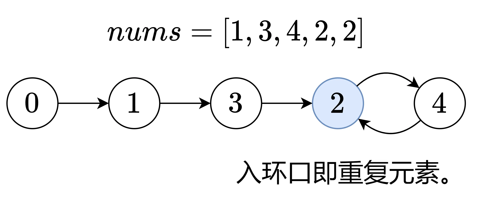

# 寻找重复数
[题目链接](https://leetcode.cn/problems/find-the-duplicate-number/description/?envType=study-plan-v2&envId=top-100-liked)

## 题目描述
给定一个包含 n + 1 个整数的数组 nums ，其数字都在 [1, n] 范围内（包括 1 和 n），可知至少存在一个重复的整数。

假设 nums 只有 一个重复的整数 ，返回 这个重复的数 。

你设计的解决方案必须 不修改 数组 nums 且只用常量级 O(1) 的额外空间。

## 解题思路
又是你最爱的技巧题，我只能说我是一点技巧都没有，吃一堑，吃一堑，再吃一堑

如果把这个数组看成链表，那么问题就迎刃而解了



问题转化成**寻找链表中环的入口**（因为环的入口被两个节点所指向），**快慢指针**就能轻松解决

在链表中，我们的移动方式是从节点 `node` 移动到下一个节点 `node.next`。

在数组中，我们的移动方式是从节点 `i` 移动到节点 `nums[i]`。由于数组长度是 `n+1`，而 `nums[i]< n+1`，所以不会下标越界。

## 代码

```c++
// 代码逻辑同 142. 环形链表 II
class Solution {
public:
    int findDuplicate(vector<int>& nums) {
        int slow = 0, fast = 0; // 0 一定不在环上，适合作为起点
        while (true) {
            slow = nums[slow]; // 等价于 slow = slow.next
            fast = nums[nums[fast]]; // 等价于 fast = fast.next.next
            if (fast == slow) { // 快慢指针移动到同一个节点
                break;
            }
        }

        int head = 0; // 再用一个指针，从起点出发
        while (slow != head) {
            slow = nums[slow];
            head = nums[head];
        }
        return slow; // 入环口即重复元素
    }
};
```