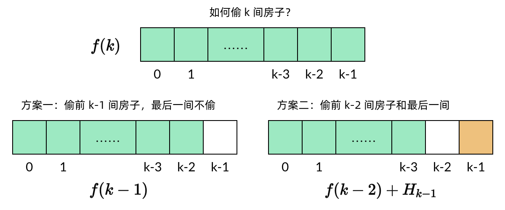

# 打家劫舍
[题目链接](https://leetcode.cn/problems/house-robber/?envType=study-plan-v2&envId=top-100-liked)

## 题目描述
你是一个专业的小偷，计划偷窃沿街的房屋。每间房内都藏有一定的现金，影响你偷窃的唯一制约因素就是相邻的房屋装有相互连通的防盗系统，**如果两间相邻的房屋在同一晚上被小偷闯入，系统会自动报警**。

给定一个代表每个房屋存放金额的非负整数数组，计算你 **不触动警报装置的情况下** ，一夜之内能够偷窃到的最高金额。
## 解题思路
这道题是动态规划的入门题目，于是直接摘选了大佬的题解，方便日后学习

动态规划的的四个解题步骤是：

定义子问题

写出子问题的递推关系

确定 DP 数组的计算顺序

空间优化（可选）

### 步骤一：定义子问题
子问题需要具备两个性质：

原问题要能由子问题表示。例如这道题中，`k=n` 时实际上就是原问题。否则，解了半天子问题还是解不出原问题，那子问题岂不是白解了。

一个子问题的解要能通过其他子问题的解求出。例如这道小偷问题中，`f(k)` 可以由 `f(k−1)` 和 `f(k−2)` 求出，具体原理后面会解释。这个性质就是教科书中所说的“最优子结构”。如果定义不出这样的子问题，那么这道题实际上没法用动态规划解。

本题由于比较简单，定义子问题实际上是很直观的。一些比较难的动态规划题目可能需要一些定义子问题的技巧。

### 步骤二：写出子问题的递推关系
这一步是求解动态规划问题最关键的一步。然而，这一步也是最**无法在代码中体现出来**的一步。在做题的时候，最好把这一步的思路用注释的形式写下来。

假设一共有 `n` 个房子，每个房子的金额分别是 `H0,H1,…,Hn−1`，子问题 `f(k)` 表示从前 `k` 个房子（即 `H0,H1,…,Hk−1`）中能偷到的最大金额。那么，偷 `k` 个房子有两种偷法：



`k` 个房子中最后一个房子是 `Hk−1`。如果不偷这个房子，那么问题就变成在前 `k−1` 个房子中偷到最大的金额，也就是子问题 `f(k−1)`。如果偷这个房子，那么前一个房子 `Hk−2`显然不能偷，其他房子不受影响。那么问题就变成在前 `k−2` 个房子中偷到的最大的金额。两种情况中，选择金额较大的一种结果。

`f(k)=max{f(k−1),Hk−1+f(k−2)}`

在写递推关系的时候，要注意写上 `k=0` 和 `k=1` 的基本情况：

当 `k=0` 时，没有房子，所以 `f(0)=0`。

当 `k=1` 时，只有一个房子，偷这个房子即可，所以 `f(1)=H0`。

这样才能构成完整的递推关系，后面写代码也不容易在边界条件上出错

### 步骤三：确定 DP 数组的计算顺序
动态规划有两种计算顺序，一种是自顶向下的、使用备忘录的递归方法，一种是自底向上的、使用 dp 数组的循环方法。**不过在普通的动态规划题目中，99% 的情况我们都不需要用到备忘录方法**，所以我们最好坚持用自底向上的 dp 数组。

那么，既然 DP 数组中的依赖关系都是向右指的，DP 数组的计算顺序就是从左向右。这样我们可以保证，计算一个子问题的时候，它所依赖的那些子问题已经计算出来了。

确定了 DP 数组的计算顺序之后，我们就可以写出题解代码了

## 代码

```c++
int rob(vector<int>& nums) {
    if (nums.size() == 0) {
        return 0;
    }

    int N = nums.size();
    vector<int> dp(N+1, 0);
    dp[0] = 0;
    dp[1] = nums[0];
    for (int k = 2; k <= N; k++) {
        dp[k] = max(dp[k-1], nums[k-1] + dp[k-2]);
    }
    return dp[N];
}
```