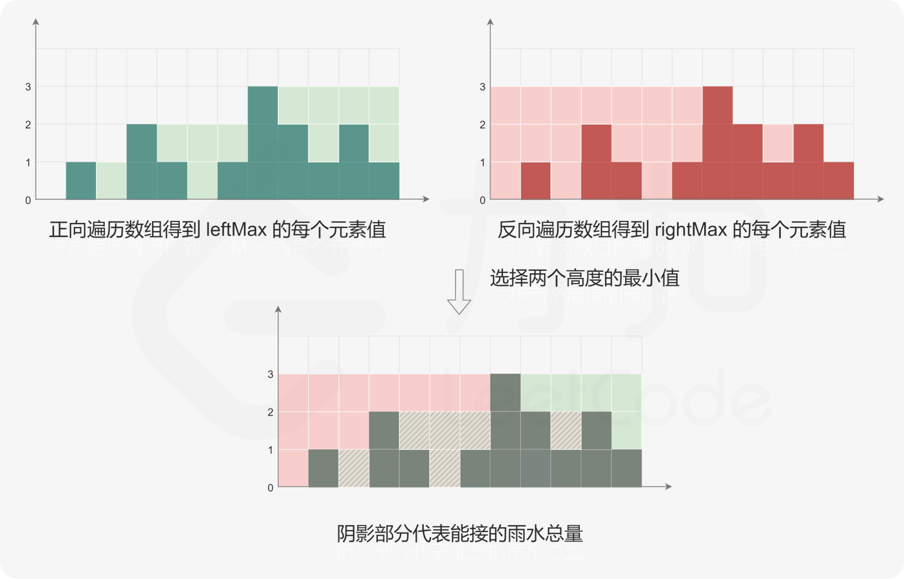

# 接雨水
[题目链接](https://leetcode.cn/problems/trapping-rain-water/description/?envType=study-plan-v2&envId=top-100-liked)

## 题目描述
给定 n 个非负整数表示每个宽度为 1 的柱子的高度图，计算按此排列的柱子，下雨之后能接多少雨水。


输入：height = [0,1,0,2,1,0,1,3,2,1,2,1]

输出：6

## 解题思路
小吕的思路（本质**动态规划**）：

采用两个数组left和right来记录左/右边的最大高度，一个正向遍历，一个反向遍历，遇到更高的就更新，否则维持；



然后，对于`0 ≤ i< n`下标i处能接的雨水量等于`min(left[i],right[i])−height[i]`，遍历每个下标位置即可得到能接的雨水总量

在动态规划的基础上加以改进，我们**不需要额外的空间**来储存高度的最大值，双指针就能很好地完成任务:

**每次移动高度更低的指针**（相等移动哪边都行），并进行一次计算：`ans += 左右边最大高度-指针当前高度`

由于我们每次移动的是高度更低的指针，所以对左边的指针进行计算时，右边的高度一定满足，反过来同理

## 代码
**动态规划版**

```c++
class Solution {
public:
    int trap(vector<int>& height) {
        int n = height.size();
        if (n == 0) {
            return 0;
        }
        vector<int> leftMax(n);
        leftMax[0] = height[0];
        for (int i = 1; i < n; ++i) {
            leftMax[i] = max(leftMax[i - 1], height[i]);
        }

        vector<int> rightMax(n);
        rightMax[n - 1] = height[n - 1];
        for (int i = n - 2; i >= 0; --i) {
            rightMax[i] = max(rightMax[i + 1], height[i]);
        }

        int ans = 0;
        for (int i = 0; i < n; ++i) {
            ans += min(leftMax[i], rightMax[i]) - height[i];
        }
        return ans;
    }
};
```

**双指针版**

```c++
class Solution {
public:
    int trap(vector<int>& height) {
        int ans = 0;
        int left = 0, right = height.size() - 1;
        int leftMax = 0, rightMax = 0;
        while (left < right) {
            leftMax = max(leftMax, height[left]);
            rightMax = max(rightMax, height[right]);
            if (height[left] < height[right]) {
                ans += leftMax - height[left];
                ++left;
            } else {
                ans += rightMax - height[right];
                --right;
            }
        }
        return ans;
    }
};
```