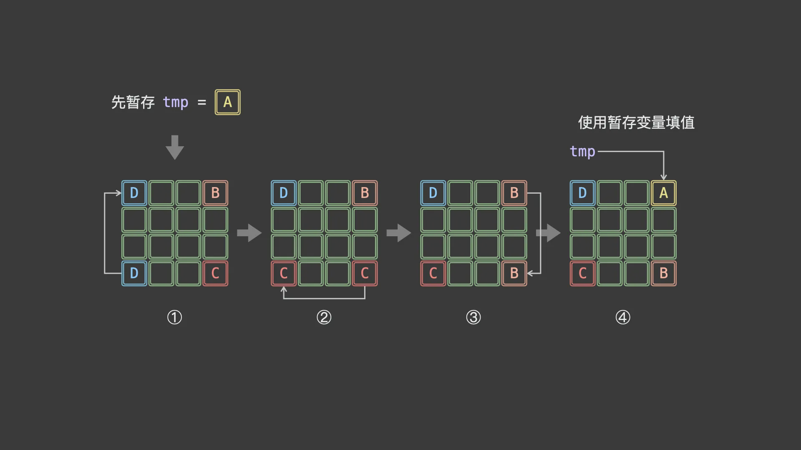

# 旋转矩阵
[题目链接](https://leetcode.cn/problems/rotate-image/description/?envType=study-plan-v2&envId=top-100-liked)

## 题目描述
给定一个 n × n 的二维矩阵 matrix 表示一个图像。请你将图像顺时针旋转 90 度。

你必须在 原地 旋转图像，这意味着你需要直接修改输入的二维矩阵。**请不要使用另一个矩阵来旋转图像**。

## 解题思路
**解法一：类似swap函数的暂存旋转**



这是我之前常用的一种方法，我们需要一个tmp变量来暂存矩阵的数据，难点在于**怎么规划路径**

之前的思路是把一个矩阵划分为4个三角（梯形）区域，就想复杂了，其实只需要把矩阵划分为4个矩形，问题就简单多了

具体来看，当矩阵大小 `n` 为偶数时，取前`n/2`行、前`n/2`列的元素为起始点；

当矩阵大小 `n` 为奇数时，取前`n/2`行、前`(n+1)/2`列的元素为起始点

这种方法无论是对于逆时针旋转90度还是旋转180度都同理

**解法二：两次翻转等价于一次旋转**

转置：把主对角线下面的元素 `matrix[i][j]` 和（关于主对角线）对称位置的元素 `matrix[j][i]` 交换。

行翻转：遍历每一行 `row=matrix[i]`，把左半边的元素 `row[j]` 和（关于垂直中轴）对称位置的元素 `row[n−1−j]` 交换。或者，使用库函数翻转 `row`。

这里还有一个值得注意的点：我们可以**使用`reverse`函数来快速完成行/列翻转**

如果是逆时针旋转90度，或是旋转180度应该怎么办呢？

很简单，只需要将**主/副对角线**转置，与**行/列翻转**这两个方法**两两组合**就可以得到：

顺时针旋转90度：主对角线转置+行翻转，或是副对角线转置+列翻转

旋转180度：行翻转+列翻转，或是主对角线转置+副对角线转置（显然前者更好实现）

逆时针旋转90度：主对角线转置+列翻转，或是副对角线转置+行翻转

## 代码
**swap旋转**
```c++
class Solution {
public:
    void rotate(vector<vector<int>>& matrix) {
        int n = matrix.size();
        for (int i = 0; i < n / 2; i++) {
            for (int j = 0; j < (n + 1) / 2; j++) {
                int tmp = matrix[i][j];
                matrix[i][j] = matrix[n - 1 - j][i];
                matrix[n - 1 - j][i] = matrix[n - 1 - i][n - 1 - j];
                matrix[n - 1 - i][n - 1 - j] = matrix[j][n - 1 - i];
                matrix[j][n - 1 - i] = tmp;
            }
        }
    }
};
```
**两次翻转**
```c++
class Solution {
public:
    void rotate(vector<vector<int>>& matrix) {
        int n = matrix.size();
        for(int i=0;i<n;i++){
            for(int j=0;j<n-i-1;j++){
                swap(matrix[i][j],matrix[n-j-1][n-i-1]);
            }
        }
        reverse(matrix.begin(),matrix.end());
    }
};
```