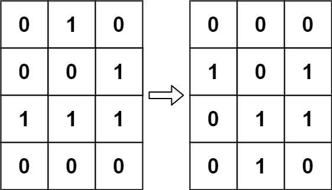

# 生命游戏
[题目链接](https://leetcode.cn/problems/game-of-life/solutions/1/c-wei-yun-suan-yuan-di-cao-zuo-ji-bai-shuang-bai-b/?envType=study-plan-v2&envId=top-interview-150)

在正式解决这道问题之前，我们先来看matrix上的一道题
## 题目描述
给定n行m列的图像各像素点的灰度值，要求用如下方法对其进行模糊化处理：

四周最外侧的像素点灰度值不变；

中间各像素点新灰度值为该像素点及其上下左右相邻四个像素点原灰度值的平均(舍入到最接近的整数）。

输入

第一行包含两个整数n和m，表示图像包含像素点的行数和列数。1≤n≤100，1≤m≤100。

接下来n行，每行m个整数，表示图像的每个像素点灰度。相邻两个整数之间用单个空格隔开，每个元素均在0∼255之间。

输出

n行，每行m个整数，表示处理后的图像。

## 解题思路
这题看上去没什么难度，但当你真正去写代码的时候就会遇到一个问题：**原数据的覆盖与污染**

听上去很吓人，其实只需要复制一份数据就好，但是这也只是权宜之计，毕竟O(n^2)的空间复杂度还是不尽人意

有没有更加省空间的方法呢？有的，兄弟有的

**原地修改 + 一行备份的做法**

逐行处理，从上到下，每行从左到右：

下一行 `i+1` 还没处理，可以直接读原值；

右边 `j+1` 还没处理，可以直接读原值；

左边 `j-1` 已改，用变量 `left` 保存原值；

上一行 `i-1` 已改，用 `prev[j]` 保存上一行原值；

当前点 `a[i][j]` 在覆盖前用 `cur` 保存。

处理完当前点后，把 `prev[j]` 更新成当前行的原值，供下一行使用。

虽然略微复杂了一些，但是确实能把空间复杂度降低到`O(n)`

还有一个需要注意的点：**怎样优雅地处理四舍五入？**

对于整数而言，`(a + b / 2) / b` 就是最优雅的写法，在本题中就是 `(sum + 2) / 5`

如果是浮点数，则可以考虑使用`round()`

## 代码

```c++
#include <bits/stdc++.h>
using namespace std;

int main() {
    int n, m;
    cin >> n >> m;
    vector<vector<int>> a(n, vector<int>(m));
    for (int i = 0; i < n; ++i)
        for (int j = 0; j < m; ++j)
            cin >> a[i][j];
    // 只有存在“中间像素”时才需要处理
    if (n > 2 && m > 2) {
        vector<int> prev = a[0]; // 保存上一行的原值，初始为第0行
        for (int i = 1; i < n - 1; ++i) {
            int left = a[i][0];  // 当前行左邻原值
            prev[0] = a[i][0];   // 更新为当前行第0列原值，供下一行使用
            for (int j = 1; j < m - 1; ++j) {
                int cur = a[i][j]; // 覆盖前保存自己的原值
                int sum = cur
                        + left
                        + a[i][j + 1]   // 右边还没处理，是原值
                        + prev[j]       // 上一行原值
                        + a[i + 1][j];  // 下一行还没处理，是原值
                a[i][j] = (sum + 2) / 5; // 非负整数四舍五入
                prev[j] = cur; // prev[j] 变成当前行原值，供下一行使用
                left = cur;    // 供当前行下一个点作为左邻原值
            }
            prev[m - 1] = a[i][m - 1]; // 当前行最后一列原值
        }
    }
    for (int i = 0; i < n; ++i) {
        for (int j = 0; j < m; ++j) {
            if (j) cout << ' ';
            cout << a[i][j];
        }
        cout << '\n';
    }
    return 0;
}
```

-------------------

开胃菜品鉴完了，接下来就进入正题

## 题目描述
给定一个包含 m × n 个格子的面板，每一个格子都可以看成是一个细胞。每个细胞都具有一个初始状态： 1 即为 活细胞 （live），或 0 即为 死细胞 （dead）。每个细胞与其八个相邻位置（水平，垂直，对角线）的细胞都遵循以下四条生存定律：

如果活细胞周围八个位置的活细胞数少于两个，则该位置活细胞死亡；

如果活细胞周围八个位置有两个或三个活细胞，则该位置活细胞仍然存活；

如果活细胞周围八个位置有超过三个活细胞，则该位置活细胞死亡；

如果死细胞周围正好有三个活细胞，则该位置死细胞复活；

下一个状态是通过将上述规则同时应用于当前状态下的每个细胞所形成的，其中细胞的出生和死亡是 同时 发生的。给你 m x n 网格面板 board 的当前状态，返回下一个状态。

给定当前 board 的状态，更新 board 到下一个状态。

注意 你不需要返回任何东西。



## 解题思路

与上一题类似，本题也需要处理**原数据的覆盖与污染**，但本题的特殊性使得我们可以采用更好的方法来处理：**使用空闲的`bit`位进行原地修改**，在输出正确答案的前提下，空间复杂度仅为`O(1)`

题目中每个细胞只有两种状态 `live(1)` 或 `dead(0)`，但我们可以**拓展一些复合状态使其包含之前的状态**。

如果细胞之前的状态是 0，但是在更新之后变成了 1，我们就可以给它定义一个复合状态 2。这样我们既能知道目前这个细胞是活的，还能知道它之前是死的。

同理，如果细胞之前的状态是 1，在更新之后还是 1，我们就可以给它定义一个复合状态 3。这样我们就能知道目前这个细胞是活的，之前也是活的。

为什么这样定义呢？可以看到0，1，2，3分别对应二进制下的00，01，10，11，也就是说，**低位记录之前的状态，高位记录现在的状态**

最后，只需要右移一位就能得到答案

## 代码

```c++
class Solution {
public:
    void gameOfLife(vector<vector<int>>& board) {
        int dx[] = {-1,  0,  1, -1, 1, -1, 0, 1};
        int dy[] = {-1, -1, -1,  0, 0,  1, 1, 1};

        for(int i = 0; i < board.size(); i++) {
            for(int j = 0 ; j < board[0].size(); j++) {
                int sum = 0;
                for(int k = 0; k < 8; k++) {
                    int nx = i + dx[k];
                    int ny = j + dy[k];
                    if(nx >= 0 && nx < board.size() && ny >= 0 && ny < board[0].size()) {
                        sum += (board[nx][ny]&1); // 只累加最低位
                    }
                }
                if(board[i][j] == 1) {
                    if(sum == 2 || sum == 3) {
                        board[i][j] |= 2;  // 使用第二个bit标记是否存活
                    }
                } else {
                    if(sum == 3) {
                        board[i][j] |= 2; // 使用第二个bit标记是否存活
                    }
                }
            }
        }
        for(int i = 0; i < board.size(); i++) {
            for(int j = 0; j < board[i].size(); j++) {
                board[i][j] >>= 1; //右移一位，用第二bit覆盖第一个bit。
            }
        }
    }
};
```