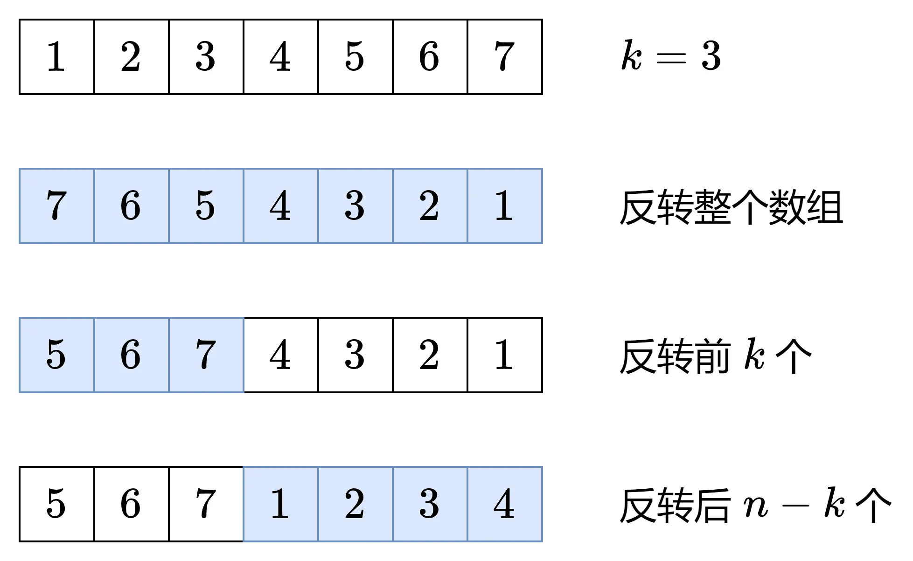

# 轮转数组
[题目链接](https://leetcode.cn/problems/rotate-array/?envType=study-plan-v2&envId=top-100-liked)

## 题目描述
给定一个整数数组 nums，将数组中的元素向右轮转 k 个位置，其中 k 是非负数。

进阶：

你可以使用空间复杂度为 O(1) 的 原地 算法解决这个问题吗？

## 解题思路
题目本身并不难，但如果想要优化到 `O(1)` 的空间复杂度就没那么简单

杂鱼的思路：1、把后K位复制并移动到开头，再删除后K位；2、使用`temp`临时储存数据，用类似`swap`的方法右移一位，递归`k`次

第一种方法的空间复杂度为`O(k)`，而且"移动到开头"不好实现；第二种方法的时间复杂度太高，不能在规定时间内完成

灵神的思路：**两次翻转，一图秒懂**



深度求索：1、改成向左轮转 `k` 个位置；2、如果 `nums` 是个二维数组呢？

## 代码

```c++
class Solution {
public:
    void rotate(vector<int>& nums, int k) {
        auto reverse = [&](int i, int j) {
            while (i < j) {
                swap(nums[i++], nums[j--]);
            }
        };//手写reverse，对于一维数组没有明显优势，但对于二维数组，效果拔群

        int n = nums.size();
        k %= n; // 轮转 k 次等同于轮转 k % n 次
        reverse(0, n - 1);
        reverse(0, k - 1);
        reverse(k, n - 1);
    }
};
```